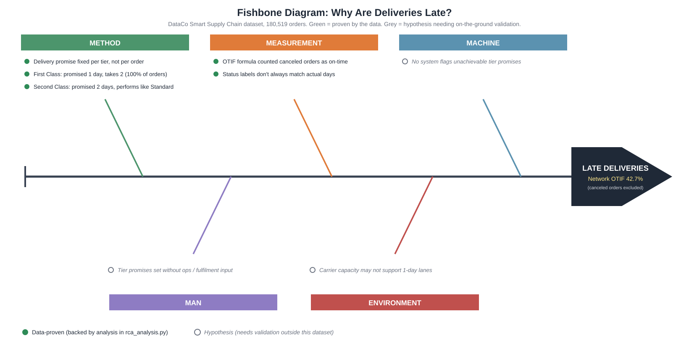

# RCA: Why Are Deliveries Late?

Root cause analysis of network-wide late deliveries, using DMAIC, 5 Whys and a
fishbone diagram on the DataCo Smart Supply Chain dataset (180,519 orders).

Follows on from [Delivery-KPI-Dashboard](https://github.com/sawantgit/Delivery-KPI-Dashboard),
which showed that delivery performance was poor in every region and category.
This project asks why.

## Result in one line

Delivery promises are fixed per shipping tier and don't match what the network
actually delivers. First Class is promised in 1 day, every one of its 27,814
orders takes 2 days, so its OTIF is 0%.

## Define

Network OTIF is 42.7% (canceled orders excluded). Poor performance appears in
every region and category, which points to a systemic cause rather than a local one.

## Measure

| Shipping mode | Share of orders | Promised (days) | Actual (days) | OTIF % |
|---|---|---|---|---|
| Standard Class | 59.7% | 4 | 4.0 (spread 2-6) | 60.2 |
| Second Class | 19.5% | 2 | 4.0 (spread 2-6) | 20.2 |
| First Class | 15.4% | 1 | 2.0 (every order) | 0.0 |
| Same Day | 5.4% | 0 | 0.5 (0 or 1) | 52.1 |

- Each tier has exactly one promised value, so promises are a fixed policy, not a per-order estimate.
- Second Class performs like Standard Class (3.99 vs 4.00 days actual) but is promised in half the time.
- Regional numbers looked uniform because every region has a similar mix of tiers.

**Data-quality note:** the original OTIF formula (`1 - Late_delivery_risk`) counted
canceled orders (about 4-5% of orders) as on-time. Excluding them lowers the
network figure and shows First Class had no on-time orders at all. Status
labels also don't always agree with the delivery-days columns.

## Analyze

Green causes are proven by the data. Grey causes are hypotheses that need
validation outside this dataset.

**5 Whys**
1. Premium tiers are late almost every time (First Class 0% OTIF, Second Class 20.2%). *(data)*
2. Their actual delivery time exceeds the promised time. *(data)*
3. The promise is one fixed number per tier and doesn't reflect actual performance. *(data)*
4. Tier promises are likely set as pricing/product commitments, not from measured performance. *(hypothesis)*
5. No feedback loop or owner reconciles promises with delivery data. *(hypothesis)*

**Root cause:** delivery promises are set per tier without a feedback loop from
actual performance, so premium tiers promise speed the network can't deliver.

## Improve

Re-baseline promises using actual delivery times. Standard Class trade-off:

| Promise | OTIF |
|---|---|
| 4 days (today) | 60.2% |
| 5 days | 79.8% |
| 6 days | 100% |

Recommended: First Class 1 to 2 days (OTIF 0% to 100%), Standard and Second
Class to 5 days (about 80%), Same Day 0 to 1 day.

This fixes the honesty of the promise, not the speed. Second Class then shows
no advantage over Standard Class, so the business must either reprice it or
investigate its fulfilment process.

## Control

- Weekly OTIF per tier (canceled orders excluded), plus the gap between actual
  90th-percentile days and the promise.
- Track the cancellation rate separately.
- Illustrative thresholds: green at 85% or above, amber 80-85%, red below 80%
  for two consecutive weeks triggers a review of that tier.
- Reset promises quarterly from the last 90 days of actual data.

## Limitations

The dataset appears synthetic (delivery days are spread evenly over 2-6), and
the what-if was tested on the same data used to set the promises. The method
(comparing promised vs actual by segment) is what carries over to real data.

## Run it

1. Download the [dataset](https://www.kaggle.com/datasets/shashwatwork/dataco-smart-supply-chain-for-big-data-analysis) and place `DataCoSupplyChainDataset.csv` in a `data/` folder.
2. `pip install pandas`
3. `python rca_analysis.py`

## Tech

Python, pandas, SVG fishbone diagram
